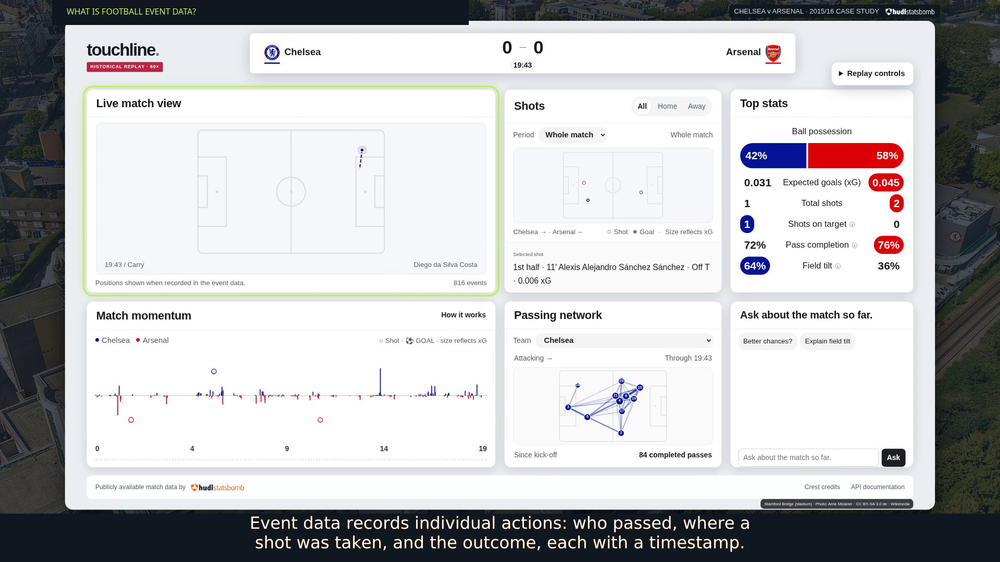
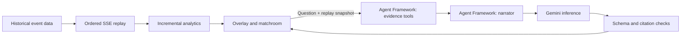

# Touchline

### See the game. Understand the story.

**Touchline turns football event data into on-screen match intelligence and AI-powered explanations—designed for live TV and streaming experiences.**

A score tells you what happened. Touchline helps you explore who is creating the danger, how teams connect their passes, and what the numbers mean. Watch the match unfold, inspect the evidence, or ask a question in everyday language.

Built for the **Microsoft × Premier League Inside the Game Developer Hackathon**. The current application is a working local prototype with **Microsoft Agent Framework orchestration, Gemini-powered match questions, historical event replay, and an optional Microsoft Foundry explanation adapter**.



## The demo: a Premier League match, one event at a time

Open **[http://127.0.0.1:8000/overlay](http://127.0.0.1:8000/overlay)** after starting the app.

The intended experience sits alongside live match footage. To avoid redistributing copyrighted broadcast video, this demonstration uses an **event-data pitch** in its place. This is a visualization of recorded actions, not reconstructed match video or continuous player tracking.

**What is event data?** A timestamped record of individual football actions: who passed, where a shot was taken, its outcome, and other recorded context. In a live Premier League deployment, those events would arrive through a licensed data provider's API.

For this case study, Touchline uses **publicly available historical Premier League 2015/16 event data from [Hudl / StatsBomb Open Data](https://github.com/hudl/open-data)**. The recorded demo follows **Chelsea–Arsenal, September 19, 2015**. The server downloads the event file, then streams actions **one at a time, in match order**, through Server-Sent Events (SSE). The score, pitch and analytics update only as events are emitted. This demonstrates the event-processing experience; a production live feed and synchronization with broadcast footage remain future integrations.

The **1:58 narrated demo** explains the live-TV concept, event data, sequential replay and AI workflow. Its local file is `artifacts/demo-real/touchline-demo-real-match.mp4`; generated video files are ignored by Git. See the [demo package and reproduction instructions](artifacts/demo-real/README.md). A public hosted video URL still needs to be added to the submission.

> **Data distinction:** the public application currently uses historical data. The hackathon also requires synthetic, football-realistic events; this case study alone does not meet that requirement. The repository includes a separate seeded synthetic demo build, described below.

## What you can explore

| Experience | What it helps a viewer understand |
| --- | --- |
| Event-data pitch and score | Follow recorded actions, player identities, the replay clock and goals as they arrive. |
| Shot map | Compare chance locations and supplied expected goals (xG). Larger markers mean higher xG; filled markers identify goals. |
| Match momentum | See attacking progression from completed open-play passes and carries using expected threat (xT). This is not win probability. |
| Top statistics | Compare estimated possession, shots, shots on target, pass completion and field tilt. |
| Passing network | Explore average pass/reception positions and connections between players; switch the team being inspected. |
| Shot snapshots | Inspect recorded shot-time player positions where available, rather than implying continuous tracking. |
| Ask the match | Ask about chance quality, territorial control or player involvement using the match context available so far. |

The overlay fits a landscape broadcast-style canvas. It starts its own replay and can also receive updates from a matchroom tab in the same browser. The main matchroom is available at **[http://127.0.0.1:8000/](http://127.0.0.1:8000/)**.

Personalization currently comes from the viewer's questions, team selection and shot exploration. Overlay chat uses casual-fan language; the chat API also supports an analyst mode. Favorite-player profiles and multilingual narration are future work.

## The AI: evidence first, explanation second

Touchline uses AI to explain measured match context. Routine scorekeeping and statistics are calculated in Python rather than delegated to a language model.

Example questions include:

- **“Who has created the better chances so far?”** Compare match-to-date chance quality.
- **“What does field tilt tell us?”** Explain territorial control in plain language.
- **“Who is most involved in the passing network?”** Explore the current player-network window.

### Microsoft Agent Framework + Gemini

Every question runs through an isolated **[Microsoft Agent Framework workflow](https://learn.microsoft.com/en-us/agent-framework/workflows/workflows)** in [app/chat_workflow.py](app/chat_workflow.py):

1. **Collect evidence.** `MatchEvidence` invokes three read-only tools: `get_match_stats`, `get_recent_events` and `get_player_summary`.
2. **Generate an explanation.** `MatchNarrator` hands that evidence to the Gemini integration in [app/chat.py](app/chat.py), requesting a short answer for the selected audience.
3. **Validate and render.** The backend validates the response schema and checks cited event IDs against the supplied event excerpt. The UI displays the answer's snapshot time and supporting events when supplied.

This is a real Microsoft orchestration integration with a Google model. Tool selection and the handoff are deterministic; the two executors are not presented as independently reasoning autonomous agents. It is not a Microsoft-hosted Gemini deployment.



### Grounding and failure behavior

Each question captures the current score, match totals, passing networks and at most **60 recent events**. Future events and final-result fields are excluded from the supplied snapshot. Player summaries describe the current passing-network window, which resets after substitutions or sending-offs; they are not full-match player totals.

These controls improve traceability, but do not prove every sentence is correct. Aggregate comparisons may have no individual event citations. The prototype currently trusts the viewing client's snapshot; public deployment needs authoritative server-side match sessions.

A real Gemini answer was verified during the earlier synthetic demo. The revised historical-match recording encountered **HTTP 429 quota exhaustion** and states that limitation explicitly. Provider failures are displayed as errors; no canned response is passed off as AI output. Replay and analytics continue independently of chat inference.

### Optional Microsoft Foundry explanations

A separate shot-triggered explanation path supports casual/analyst output through **Microsoft Foundry**, using Azure OpenAI v1 chat completions and JSON-schema validation. Its local default is a deterministic template marked `ai_generated=false`.

This adapter is implemented but **has not been verified against a real Foundry deployment**. It serves the optional SSE insight path, not the Gemini chat endpoint. See the configuration below before claiming Foundry usage.

## Where Microsoft technologies fit

The working Agent Framework integration provides the foundation. Additional services have specific roles as the prototype moves toward a shared broadcast deployment:

| Microsoft technology | Role in Touchline | Status |
| --- | --- | --- |
| **Microsoft Agent Framework** | Coordinate evidence collection and narration, with explicit tool boundaries and a per-question handoff. | **Implemented locally**; real Gemini inference verified in development. |
| **Microsoft Foundry** | Generate structured explanations for important moments through the existing optional provider. | Adapter implemented; real deployment verification pending. |
| **Azure Container Apps** | Host the FastAPI application and analytics service. | Proposed; no container image or Azure deployment included yet. |
| **Azure Web PubSub** | Deliver shared match updates to viewer groups rather than independently replaying every connection. | Proposed; requires authoritative sessions, sequencing and recovery. |
| **Azure Monitor / Application Insights** | Measure event-to-screen latency, workflow errors and model response times. | Proposed; instrumentation and benchmarks remain to be built. |
| **Azure Key Vault and managed identity** | Manage deployment secrets and access as cloud integrations are introduced. | Proposed; the local app uses server-side environment variables. |

These choices support the hackathon's emphasis on Microsoft AI, explainable intelligence and broadcast applicability. They are a deployment direction, not claims of completed cloud integration. See the [Microsoft integration and deployment plan](docs/microsoft-deployment.md).

## Keep routine updates cheap; use AI where it adds value

Touchline can run its replay, charts and statistics locally without an AI key or cloud provisioning. The frontend uses plain JavaScript/SVG, with no Node build step. Match questions trigger inference **only when the viewer asks**, rather than once for every pass or chart update.

The optional Foundry path also limits work: shots trigger explanations, with one request in flight, a default 30-second cooldown and at most 12 requests per replay connection. Its labeled local template mode makes no model calls. These controls apply to that explanation path, not to chat; neither is a global spending cap.

For an Azure pilot, [Container Apps Consumption supports scale-to-zero](https://learn.microsoft.com/azure/container-apps/plans), which could reduce idle compute usage. A live match service still needs a deliberate availability policy, shared state, and tested streaming/recovery behavior. Consumption hosting does not make model inference, data licensing or all supporting services free. No operating-cost benchmark or guaranteed free-tier availability is claimed.

## Run locally

Requires **Python 3.14**, **Pipenv**, and internet access to retrieve historical fixtures/events. Cloud credentials are optional for the core viewing experience.

```bash
PIPENV_VENV_IN_PROJECT=1 pipenv sync --dev
cp .env.example .env
pipenv run dev
```

If `.env` already exists, retain it and add only the settings you need. The development command opens the overlay once the server is ready and reloads code changes.

| Address | Purpose |
| --- | --- |
| [localhost:8000/overlay](http://127.0.0.1:8000/overlay) | Broadcast-style viewing experience; choose a fixture and press **Start replay**. |
| [localhost:8000/](http://127.0.0.1:8000/) | Main matchroom. |
| [localhost:8000/docs](http://127.0.0.1:8000/docs) | Interactive API documentation. |
| [localhost:8000/health](http://127.0.0.1:8000/health) | Health check: `{"status":"ok"}`. |

The standard overlay offers real time and 2× playback. The recorded case study adds a 60× choice for presentation; the API also accepts accelerated replay directly.

### Enable AI questions

Add a server-side Gemini key to `.env`, then restart the application:

```dotenv
GAME_GEMINI_API_KEY=YOUR_KEY
GAME_GEMINI_MODEL=YOUR_AVAILABLE_GEMINI_MODEL
```

Select a model your account can access. The code's default is recorded in [.env.example](.env.example); availability and quota depend on the provider/account. Never commit `.env` or put a model key in browser code.

### Enable optional Foundry insights

Use a deployment supporting chat completions with strict JSON-schema outputs:

```dotenv
GAME_EXPLANATION_PROVIDER=foundry
GAME_FOUNDRY_ENDPOINT=https://YOUR-RESOURCE.openai.azure.com
GAME_FOUNDRY_DEPLOYMENT=YOUR-DEPLOYMENT-NAME
GAME_FOUNDRY_API_KEY=YOUR_KEY
```

Use the HTTPS resource root, not a project URL or `/models` path. A Foundry `https://RESOURCE.services.ai.azure.com` resource root is also supported. After restarting, run the explicit smoke check only when ready to make a potentially billable request:

```bash
pipenv run python -m app.check_foundry
```

A successful real response exits with code 0 and reports `provider=microsoft_foundry`; a labeled fallback exits with code 1. Without Foundry, retain `GAME_EXPLANATION_PROVIDER=template`, or use `off` to disable this explanation path.

## API and replay behavior

| Endpoint | Purpose |
| --- | --- |
| `GET /matches` | Available StatsBomb Premier League 2015/16 fixtures, omitting final scores. |
| `GET /matches/{match_id}/stream` | SSE replay: `match`, incremental `update`, optional `insight`, then `complete`. |
| `POST /chat` | A question, `simple`/`analyst` mode and bounded replay snapshot; returns an answer or explicit provider error. |
| `GET /health` | Application health. |

```bash
# One match minute per wall-clock second; no LLM inference.
curl -N 'http://127.0.0.1:8000/matches/3754217/stream?speed=60'

# Optional shot-triggered templates or Foundry output, depending on configuration.
curl -N 'http://127.0.0.1:8000/matches/3754217/stream?speed=60&insights=true&audience=analyst'
```

Replay connections have independent state. Disconnecting cancels replay; reconnecting starts again from kick-off. Resume, shared server sessions and production broadcast-clock synchronization are not implemented. The in-browser BroadcastChannel supports same-browser tabs, not independent OBS browser sources or viewers on another device.

StatsBomb xG is supplied by the dataset. xT uses the public pretrained 12×8 grid described in [the model notes](docs/xt-model.md), without fitting on the replayed match. Momentum measures signed per-action progression, not defensive value or scoring probability. Shot-map display places home attacks toward the right and away attacks toward the left; shot snapshots use their own period-specific direction convention. Missing coordinates/snapshots are not inferred as tracking data.

## Hackathon alignment and remaining work

The project follows the challenge's ingest → interpret → explain → render → personalize pipeline. The five judging areas below carry equal 20% weights. The [official rules](https://github.com/microsoft/insidethegamehackathon/blob/main/OFFICIAL%20RULES.md) are the authority; the event's Innovation Studio page required sign-in when checked on October 21, 2026.

| Judging area | Evidence and remaining work |
| --- | --- |
| Technological implementation | Incremental replay/analytics and reproducible setup; richer synthetic-data generation and validation remain. |
| Agentic design and innovation | A working evidence-to-narration workflow with three tools; broader evaluation is still needed. |
| Real-world impact | A broadcast/streaming presentation concept; shared sessions, licensed live feeds and synchronization remain. |
| User experience and presentation | Working overlay, interactive questions and a narrated case study; expanded audience/language modes remain. |
| Category adherence | Match category claims to demonstrated functionality; planned Foundry/Azure services are not evidence of deployment. |

**Synthetic-data work:** [app/synthetic.py](app/synthetic.py) generates seeded fictional events. A separate [synthetic demo build](tools/demo/README.md) runs that source through the same analytics and overlay. It is separate from the public application's historical fixture selector. Its heuristic xG is illustrative and football realism still needs evaluation and broader event coverage.

Before submission:

- Validate football-realistic synthetic data and demonstrate it in a judge-accessible build.
- Confirm category fit, registration, eligibility and third-party permissions.
- Publish the GitHub repository and an English demo **under two minutes** on an accepted public video host.
- Supply reproducible test instructions and keep the build accessible through judging.

## Development and project map

```bash
pipenv run test
pipenv run lint
pipenv run format --check
```

Dependencies are managed with Pipenv; commit `Pipfile` and `Pipfile.lock`. For dependency changes, use `pipenv install` or `pipenv install --dev` and retain the lock file. Demo video tooling is separate from application runtime dependencies.

| Path | Responsibility |
| --- | --- |
| [app/main.py](app/main.py) | FastAPI routes and application wiring. |
| [app/source.py](app/source.py), [app/replay.py](app/replay.py) | Historical data ingestion and ordered streaming. |
| [app/analytics.py](app/analytics.py), [app/passing.py](app/passing.py) | Incremental match calculations and passing networks. |
| [app/chat_workflow.py](app/chat_workflow.py), [app/chat.py](app/chat.py) | Agent Framework orchestration, Gemini inference and citation checks. |
| [app/explanations.py](app/explanations.py) | Optional template/Foundry shot explanations. |
| [app/static/](app/static/) | Overlay, matchroom, charts and chat interface. |
| [tests/](tests/) | Replay, analytics, source, workflow and provider tests. |
| [tools/demo/](tools/demo/) | Reproducible recording, narration and export scripts. |

## Data, assets and license

The [repository license](LICENSE) covers this project's code. Third-party data, model grids, club crests, stadium photographs and logos retain their own terms. StatsBomb attribution and logo are displayed in the app; publicly available data is not blanket permission to redistribute or commercially exploit it.

See [asset credits](docs/assets.md), [asset provenance](app/static/assets/sources.json), the [xT model notes](docs/xt-model.md), and [StatsBomb's data license](https://github.com/hudl/open-data/blob/master/LICENSE.pdf). An event-data pitch avoids using broadcast video; it does not remove the need to verify rights to the data and assets used.
