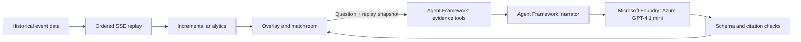

# Touchline

[](https://github.com/hadisotudeh/Inside-the-Game-Hackathon/actions/workflows/checks.yml)

[Watch the demo](https://youtu.be/Q1jKv-HsTxo) · [Open the Azure app](https://touchline-inside-the-game.azurewebsites.net)

Choose a fixture, press **Start replay**, explore the charts, and ask the match a question.
The app is already hosted on Azure App Service; chat uses Azure-hosted GPT-4.1 mini through Microsoft Foundry.

### Your AI football companion ⚽💻

Live stats, match stories, and answers for football fans and commentators.

Touchline brings shot maps, attacking momentum, passing networks, and AI match notes into one screen. Follow the notes as play develops, select a shot for a closer look, or switch to **Ask the match** with a question of your own.

Built by **[Hadi Sotudeh](https://www.linkedin.com/in/hadisotudeh)** for the **Microsoft × Premier League Inside the Game Developer Hackathon**, using Python/FastAPI, Microsoft Agent Framework, and Azure-hosted GPT-4.1 mini through Microsoft Foundry. The current demo replays historical events as they arrive; a licensed live feed is planned.


## The demo: a Premier League match, one event at a time

Open **[touchline-inside-the-game.azurewebsites.net](https://touchline-inside-the-game.azurewebsites.net)** in your browser. For local development, start the app and open [localhost:8000](http://127.0.0.1:8000/).

The intended experience sits alongside live match footage. To avoid redistributing copyrighted broadcast video, this demonstration uses an **event-data pitch** in its place. This is a visualization of recorded actions, not reconstructed match video or continuous player tracking.

**What is event data?** A timestamped record of individual football actions: who passed, where a shot was taken, its outcome, and other recorded context. In a live Premier League deployment, those events would arrive through a licensed data provider's API.

For this case study, Touchline uses **publicly available historical Premier League 2015/16 event data from [Hudl / StatsBomb Open Data](https://github.com/hudl/open-data)**. The recorded demo follows **Chelsea–Arsenal, September 19, 2015**. The server downloads the event file, then streams actions **one at a time, in match order**, through Server-Sent Events (SSE). The score, pitch and analytics update only as events are emitted. This demonstrates the event-processing experience; a production live feed and synchronization with broadcast footage remain future integrations.

The **115-second demo** follows Chelsea–Arsenal at 15× speed. It shows shot selection, the growing momentum chart, passing networks, automatic match notes, and **Ask the match**, followed by a walkthrough of the Microsoft Agent Framework workflow. The voiceover uses synthetic narration based on Hadi Sotudeh’s voice, with his permission. See the [recording and reproduction details](docs/demo-package/README.md).

> **For judges:** the video is a historical-data case study. Run `pipenv run demo` and open [localhost:8012/overlay](http://127.0.0.1:8012/overlay) to test the separate, labeled synthetic build. It uses fictional teams and seed 42 without downloading historical match data. See [step-by-step testing instructions](docs/judging.md).

## What you can explore

| Experience | What it helps a viewer understand |
| --- | --- |
| Event-data pitch and score | Follow recorded actions, player identities, the replay clock and goals as they arrive. |
| Shot map | Compare chance locations and supplied expected goals (xG). Larger markers mean higher xG; filled markers identify goals. |
| Match momentum | Follow recent attacking threat through a filled, minute-based xT proxy chart, with home/away colors, halftime separation and goal markers. The time axis expands with elapsed play, compressing earlier events as the replay progresses. This is not scoring or win probability. |
| Top statistics | Compare estimated possession, shots, shots on target, pass completion and field tilt. |
| Passing network | Explore average pass/reception positions and connections between players; switch the team being inspected. |
| Shot snapshots | Inspect recorded shot-time player positions where available, rather than implying continuous tracking. |
| AI interpretation timeline | Receive automatic, timestamped notes grounded in the match snapshot; this is the default panel mode. |
| Ask the match | Switch modes to ask about chance quality, territorial control or player involvement using the match context available so far. |

The **Match intelligence** panel starts in **AI interpretation timeline** mode, generating automatic, timestamped notes as replay unfolds. Use its dropdown to switch to **Ask the match** whenever you want to ask a question. Switching modes preserves the replay and existing notes. Interpretations use the same workflow and match evidence as chat. They run only in timeline mode, with at least five match minutes and 20 wall-clock seconds between successful notes, and at most 12 generation attempts per replay. Resetting starts a fresh timeline.

The overlay fits a landscape broadcast-style canvas. It starts its own replay and can also receive updates from a matchroom tab in the same browser. The main matchroom is available at **[http://127.0.0.1:8000/matchroom](http://127.0.0.1:8000/matchroom)**.

Personalization currently comes from the viewer's questions, team selection and shot exploration. Overlay chat uses casual-fan language; the chat API also supports an analyst mode. Favorite-player profiles and multilingual narration are future work.

## How match explanations work

Touchline uses AI to explain measured match context. Routine scorekeeping and statistics are calculated in Python rather than delegated to a language model.

Example questions include:

- **“Who has created the better chances so far?”** Compare match-to-date chance quality.
- **“What does field tilt tell us?”** Explain territorial control in plain language.
- **“Who is most involved in the passing network?”** Explore the current player-network window.

### Microsoft Agent Framework + Microsoft Foundry

The hosted app uses **Azure-hosted GPT-4.1 mini through Microsoft Foundry** for match questions and automatic notes. Gemini is also supported for local use. See [Azure configuration](docs/azure-free.md).

Every question runs through an isolated **[Microsoft Agent Framework workflow](https://learn.microsoft.com/en-us/agent-framework/workflows/workflows)** in [app/chat_workflow.py](app/chat_workflow.py):

1. **Collect evidence.** `MatchEvidence` invokes three read-only tools: `get_match_stats`, `get_recent_events` and `get_player_summary`.
2. **Generate an explanation.** `MatchNarrator` hands that evidence to Azure-hosted GPT-4.1 mini through the Foundry integration in [app/chat.py](app/chat.py), requesting a short answer for the selected audience.
3. **Validate and render.** The backend validates the response schema and checks cited event IDs against the supplied event excerpt. The UI displays the answer's snapshot time and supporting events when supplied.

The workflow calls the same three tools for each question, then passes their results to the narrator. Tool selection and the handoff are deterministic.



### Grounding and failure behavior

Each question captures the current score, match totals, passing networks and at most **60 recent events**. Future events and final-result fields are excluded from the supplied snapshot. Player summaries describe the current passing-network window, which resets after substitutions or sending-offs; they are not full-match player totals.

These controls improve traceability, but do not prove every sentence is correct. Aggregate comparisons may have no individual event citations. The prototype currently trusts the viewing client's snapshot; public deployment needs authoritative server-side match sessions.

If the model provider fails, the panel displays an error. Replay and analytics continue independently.

### Optional Microsoft Foundry explanations

A separate shot-triggered explanation path supports casual/analyst output through **Microsoft Foundry**, using Azure OpenAI v1 chat completions and JSON-schema validation. Its local default is a deterministic template marked `ai_generated=false`.

This adapter is implemented but **has not been verified against a real Foundry deployment**. It serves the optional SSE insight path, not the match-question chat endpoint. Configuration is described below.

## Technology

| Component | Role |
| --- | --- |
| Python / FastAPI | Serve the app, process events, and stream replay updates. |
| JavaScript / SVG | Render the pitch, charts, passing networks, and chat interface. |
| Microsoft Agent Framework | Collect match evidence and pass it to the narrator. |
| Microsoft Foundry | Serve Azure-hosted GPT-4.1 mini for match notes and questions. |
| Azure App Service | Host the demo on a Linux App Service plan. |

Deployment details and future infrastructure options are covered in the [Microsoft integration plan](docs/microsoft-deployment.md).

## Hosting and model usage

Touchline can run its replay, charts and statistics locally without an AI key or cloud provisioning. The frontend uses plain JavaScript/SVG, with no Node build step. Match questions trigger inference **only when the viewer asks**, rather than once for every pass or chart update.

The optional Foundry path also limits work: shots trigger explanations, with one request in flight, a default 30-second cooldown and at most 12 requests per replay connection. Its labeled local template mode makes no model calls. These controls apply to that explanation path, not to chat; neither is a global spending cap.

The hosted demo runs on Azure App Service's free Linux plan in Sweden Central. Model inference is billed separately by token usage and currently uses student credit. See [deployment details](docs/azure-free.md) for resource configuration and limits.

## Run locally

For the self-contained synthetic judge build, install dependencies as below, then run `pipenv run demo` instead of `pipenv run dev`. The synthetic overlay is on port **8012**; its replay and analytics need no data-provider credentials or network calls after installation. AI questions require server-side Azure model credentials or an optional Gemini key.

Requires **Python 3.14**, **Pipenv**, and internet access to retrieve historical fixtures/events. Cloud credentials are optional for the core viewing experience.

```bash
PIPENV_VENV_IN_PROJECT=1 pipenv sync --dev
cp .env.example .env
pipenv run dev
```

If `.env` already exists, retain it and add only the settings you need. The development command opens the overlay once the server is ready and reloads code changes.

| Address | Purpose |
| --- | --- |
| [localhost:8000/](http://127.0.0.1:8000/) | Broadcast-style viewing experience; choose a fixture and press **Start replay**. |
| [localhost:8000/matchroom](http://127.0.0.1:8000/matchroom) | Main matchroom. |
| [localhost:8000/docs](http://127.0.0.1:8000/docs) | Interactive API documentation. |
| [localhost:8000/health](http://127.0.0.1:8000/health) | Health check: `{"status":"ok"}`. |

The overlay and matchroom offer real time, 2× and 15× playback. Choose 15× to build up match evidence faster; the demo uses this same option. The API also accepts other accelerated replay speeds.

### Enable local AI narration and chat

The hosted app uses Azure GPT-4.1 mini. Localhost needs its own configuration:
edit `.env` in the project root (beside `README.md`) and set the following values.
Both the default **AI interpretation timeline** and **Ask the match** use these settings.

If `.env` does not exist yet, create it with `cp .env.example .env`. If it already
exists, edit the existing entries instead of adding duplicate settings.

```dotenv
GAME_CHAT_PROVIDER=foundry
GAME_FOUNDRY_ENDPOINT=https://YOUR-RESOURCE.openai.azure.com
GAME_FOUNDRY_DEPLOYMENT=YOUR-DEPLOYMENT-NAME
GAME_FOUNDRY_API_KEY=YOUR_AZURE_RESOURCE_KEY
```

Use your own Azure resource endpoint, deployment name, and key. Copy the key from the resource's **Keys and Endpoint** section into `GAME_FOUNDRY_API_KEY`.
After saving `.env`, stop the running local server with **Ctrl+C** and restart it:

```bash
pipenv run dev
```

Open `http://127.0.0.1:8000`, select a fixture and press **Start replay**. The timeline
waits until the first match minute and some events have arrived before generating
its first interpretation. With no working model credentials, charts and replay
still work, but AI text cannot be generated. See [Azure configuration](docs/azure-free.md).

`GAME_EXPLANATION_PROVIDER` controls a separate optional shot-insights feature;
it does not enable the dropdown's narration timeline or chat. Keep keys on the
server in the ignored `.env` file, never in the browser or Git.

For the optional legacy Gemini provider, set `GAME_CHAT_PROVIDER=gemini`.
Add a server-side Gemini key to `.env`, then restart the application:

```dotenv
GAME_GEMINI_API_KEY=YOUR_KEY
GAME_GEMINI_MODEL=YOUR_AVAILABLE_GEMINI_MODEL
```

Select a model your account can access. The code's default is recorded in [.env.example](.env.example); availability and quota depend on the provider/account. Never commit `.env` or put a model key in browser code.

### Enable optional Foundry insights

Use a deployment supporting chat completions with strict JSON-schema outputs:

```dotenv
GAME_EXPLANATION_PROVIDER=foundry
GAME_FOUNDRY_ENDPOINT=https://YOUR-RESOURCE.openai.azure.com
GAME_FOUNDRY_DEPLOYMENT=YOUR-DEPLOYMENT-NAME
GAME_FOUNDRY_API_KEY=YOUR_KEY
```

Use the HTTPS resource root, not a project URL or `/models` path. A Foundry `https://RESOURCE.services.ai.azure.com` resource root is also supported. After restarting, run the explicit smoke check only when ready to make a potentially billable request:

```bash
pipenv run python -m app.check_foundry
```

A successful real response exits with code 0 and reports `provider=microsoft_foundry`; a labeled fallback exits with code 1. Without Foundry, retain `GAME_EXPLANATION_PROVIDER=template`, or use `off` to disable this explanation path.

## API and replay behavior

| Endpoint | Purpose |
| --- | --- |
| `GET /matches` | Available StatsBomb Premier League 2015/16 fixtures, omitting final scores. |
| `GET /matches/{match_id}/stream` | SSE replay: `match`, incremental `update`, optional `insight`, then `complete`. |
| `POST /chat` | A question, `simple`/`analyst` mode and bounded replay snapshot; returns an answer or explicit provider error. |
| `GET /health` | Application health. |

```bash
# One match minute per wall-clock second; no LLM inference.
curl -N 'http://127.0.0.1:8000/matches/3754217/stream?speed=60'

# Optional shot-triggered templates or Foundry output, depending on configuration.
curl -N 'http://127.0.0.1:8000/matches/3754217/stream?speed=60&insights=true&audience=analyst'
```

Replay connections have independent state. Disconnecting cancels replay; reconnecting starts again from kick-off. Resume, shared server sessions and production broadcast-clock synchronization are not implemented. The in-browser BroadcastChannel supports same-browser tabs, not independent OBS browser sources or viewers on another device.

StatsBomb xG is supplied by the dataset. xT uses the public pretrained 12×8 grid described in [the model notes](docs/xt-model.md), without fitting on the replayed match. Momentum compares capped location-xT minute peaks over a recency-weighted four-minute window. Its filled chart is inspired by FotMob’s presentation; it uses our own proxy, not FotMob’s proprietary calculation or a scoring probability. Shot-map display places home attacks toward the right and away attacks toward the left; shot snapshots use their own period-specific direction convention. Missing coordinates/snapshots are not inferred as tracking data.

## Synthetic matches

**Synthetic build:** [app/synthetic.py](app/synthetic.py) generates fictional 90-minute matches with seed 42, two 11-player rosters, possession ownership, linked pass recipients, completed/incomplete passes, carries, shots, pressure and ball recoveries. Completed passes preserve the receiver as the next ball carrier within a spell. The generator feeds the same replay, analytics, passing-network and Agent Framework chat paths through `pipenv run demo`. Tests check reproducibility, event order, coordinates, rosters, pass recipients, shot probabilities, score consistency, and offline synthetic replay. The generator is deliberately simplified: attacking spells reset their starting locations, player movement between spells is not simulated, and xG is an uncalibrated heuristic. These checks establish structural consistency, not expert validation of football realism.

## Roadmap

- Connect a licensed live event feed and synchronize updates with match footage.
- Add shared server-side match sessions and replay recovery.
- Evaluate explanation quality and synthetic match realism.
- Add favorite-player views and multilingual match notes.

## Development and project map

GitHub Actions checks the dependency lock, lint, formatting, and tests on pushes and pull requests. Run the same checks locally:

```bash
pipenv run test
pipenv run lint
pipenv run format --check
```

Dependencies are managed with Pipenv; commit `Pipfile` and `Pipfile.lock`. For dependency changes, use `pipenv install` or `pipenv install --dev` and retain the lock file. Demo video tooling is separate from application runtime dependencies.

| Path | Responsibility |
| --- | --- |
| [app/main.py](app/main.py) | FastAPI routes and application wiring. |
| [app/source.py](app/source.py), [app/replay.py](app/replay.py) | Historical data ingestion and ordered streaming. |
| [app/analytics.py](app/analytics.py), [app/passing.py](app/passing.py) | Incremental match calculations and passing networks. |
| [app/chat_workflow.py](app/chat_workflow.py), [app/chat.py](app/chat.py) | Agent Framework orchestration, Azure Foundry/Gemini providers and citation checks. |
| [app/explanations.py](app/explanations.py) | Optional template/Foundry shot explanations. |
| [app/static/](app/static/) | Overlay, matchroom, charts and chat interface. |
| [tests/](tests/) | Replay, analytics, source, workflow and provider tests. |
| [tools/demo/](tools/demo/) | Reproducible recording, narration and export scripts. |

## Data, assets and license

The [repository license](LICENSE) covers this project's code. Third-party data, model grids, club crests, stadium photographs and logos retain their own terms. StatsBomb attribution and logo are displayed in the app; publicly available data is not blanket permission to redistribute or commercially exploit it.

See [asset credits](docs/assets.md), [asset provenance](app/static/assets/sources.json), the [xT model notes](docs/xt-model.md), and [StatsBomb's data license](https://github.com/hudl/open-data/blob/master/LICENSE.pdf). An event-data pitch avoids using broadcast video; it does not remove the need to verify rights to the data and assets used.
